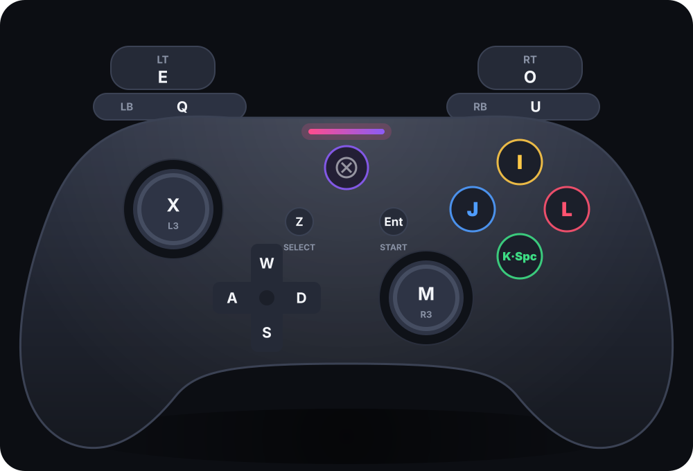
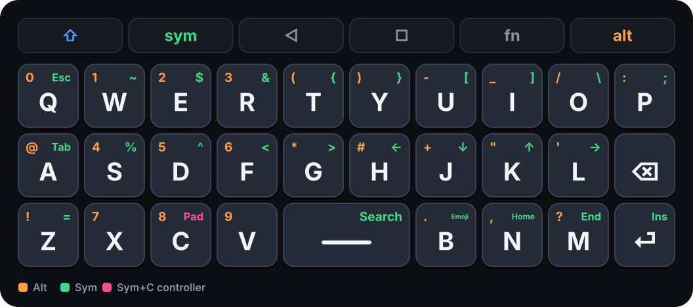

<div align="center">

# Titan2 Keys

**A full custom keyboard for the Unihertz Titan 2.**<br>
Your own layout · emoji panel · controller layer · key locks · Super key · no root

### [⬇ Download titan2-keys.apk](https://github.com/lukestogsdill/titan2-custom-kcm/raw/main/titan2-keys.apk)



<sub>The controller layer: press Sym + C and the keyboard is a gamepad. Every button shows its key.</sub>

</div>

---

The Titan 2 has a great physical keyboard, but Android keeps treating it like an afterthought: an onscreen keyboard that pops up over everything, symbols you can't reach, no arrows, no Esc. **Titan2 Keys** fixes all of that with one app:

| | |
| --- | --- |
| ⌨️ **A layout that makes sense** | Numbers and symbols on **Alt**, arrows, Tab, Esc, Home/End on **Sym**. |
| ✏️ **Change any key, on the phone** | Pick what every key types alone and with Shift, Alt or Sym: a character, text, an arrow, an F-key, or nothing. |
| 😀 **Emoji panel, Sym + B** | The onscreen keyboard stays out of the way (like "No Keyboard") until you want emoji. Type to search: `fire`, `thumbs up`. |
| 🎮 **Controller layer, Sym + C** | The keyboard becomes a gamepad for Moonlight game streaming. Rebind every button on a drawn controller that lights up as you press. |
| 🔒 **Key locks** | Double-tap Shift, Alt or Sym to lock it. A badge in the status bar shows what's on. |
| ❖ **Super key** | Hold Home to turn on Super (the Windows key) for Hyprland and other desktop shortcuts over Moonlight. |

No root, no ExKeyMo, no extra apps. One APK.

## Install

1. **[Download titan2-keys.apk](https://github.com/lukestogsdill/titan2-custom-kcm/raw/main/titan2-keys.apk)** on the phone and open it to install (allow installs from your browser if Android asks).
2. Open **Titan2 Keys**. It walks you through 4 steps with a button for each, and ticks them off as you go:
   1. **Pick the Titan 2 Custom layout** (Physical keyboard settings). On newer Android the layout is chosen per keyboard app, so pick it again after step 3.
   2. **Turn on Titan2 Emoji**, the keyboard.
   3. **Switch to Titan2 Emoji.** It replaces your onscreen keyboard.
   4. **Turn on Titan2 Key locks & Super** (Accessibility). If it's greyed out ("restricted setting"), tap the link under the step: App info → ⋮ → **Allow restricted settings**. Android does this for every app installed outside the Play Store.
3. Optional: **Settings → Shortcut keys → Fn → Control** makes Fn a Ctrl key.

Updating is the same: download the new APK and open it. Your settings stay.

## The layout



Hold **Alt** for the orange characters, **Sym** for the green ones. Sym + B opens the emoji panel, Sym + C turns on the controller.

## ✏️ Change the layout

Titan2 Keys → **Keyboard layout** shows the keyboard with what every key types. To change a key:

1. **Tap it**, or press it. Hold Shift, Alt or Sym as you press it to go straight to that layer.
2. **Tap a layer** (Base, Shift, Alt or Sym) and either type what it should type (a character, an emoji, some text, or a code like `U+00E9` for é) or pick a key: arrows, Home/End, Page Up/Down, Tab, Esc, Enter, Backspace, Delete, Cut/Copy/Paste, F1–F12, the emoji panel, the controller, or **Nothing**.

It works as soon as you pick it. Changed keys get a pink dot. **Same as Base** clears a layer, **Reset key** and **Reset everything** go back to the built-in layout, and **Try it** is a box to type in without leaving the screen.

- Locks follow your layout: Alt lock types your Alt layer, Sym lock your Sym layer. Caps lock capitalizes keys whose Shift is the capital of Base.
- You can move the emoji panel and the controller toggle too. Put "Emoji panel" or "Controller" on any key.
- Characters a US keyboard has go out as real key presses, so they work in Moonlight. Other characters (é, €, emoji) and longer text are typed as text: text fields take them, but Moonlight and games may not.
- Shift, Sym, Alt, Fn, Back and Recent can't be changed here. Neither can holding Home for Super.
- Changes need Titan2 Emoji as the keyboard and the key locks & Super service on (setup steps 2–4). Without them the keyboard types the built-in layout.
- **Export .kcm** saves your layout as a file and **Import .kcm** loads one, for another phone or a backup. To make it the built-in layout, save it over `titan2-custom.kcm` and rebuild. Text and the controller toggle can't go in a .kcm: they're written as comments, and importing keeps your current ones.

## 😀 Emoji panel (Sym + B)

- Tap an emoji to insert it. The panel stays open so you can pick several.
- Or type to search by name (`fire`, `thumbs up`). **Enter** inserts the highlighted one and closes the panel.
- **Sym+H/J/K/L** move the highlight, **Sym+A** (Tab) switches category, **Sym+Q** (Esc) clears the search, **Backspace** edits it.
- **Sym+B** or **Back** closes the panel. Recently used emoji get their own tab.

In Moonlight, typing goes to the stream, so use touch there.

## 🎮 Controller layer (Sym + C)

**Sym + C** turns it on and off (you'll feel a tick and see **PAD** at the top of the screen). You can move it to another key in the layout editor. While it's on, the bound keys are gamepad buttons and every other key types as usual.

**Defaults:** WASD is the D-pad, I J K L are Y X A B, Q / E are LB / LT, U / O are RB / RT, Space is A too, Enter is Start, Z is Select, X / M click the sticks.

**Rebind:** Titan2 Keys → **Controller layer**. Tap a button on the controller, press the key you want: any key works, including Shift, Alt, Ctrl, Backspace and the volume keys. **Clear** unbinds a button, **Reset to defaults** brings the defaults back. Press keys on that screen to test: their buttons light up and the controller tilts with the D-pad.

> **Moonlight setup (once):** Settings → Input Settings → turn off **Automatic gamepad presence detection**. Otherwise Moonlight tells the PC there's no gamepad and the buttons get ignored.

- Hold **Sym** for the normal Sym layer (Sym+H/J/K/L are still arrows, Sym+C turns the controller off).
- Hold **Alt** to type digits, unless you've bound Alt as a button.
- Home still toggles Super. Back and the other system keys can't be bound.
- No analog sticks (Android doesn't let an app fake them), so games need to work with the D-pad.
- Moonlight's own controller shortcuts apply: holding Start toggles its mouse mode, Start+Select+LB+RB ends the stream.

It's made for Moonlight. Android games may or may not accept the buttons.

## 🔒 Key locks (double-tap Shift, Alt or Sym)

| Double-tap | Locks    | Affects                                       |
| ---------- | -------- | --------------------------------------------- |
| Shift      | **CAPS** | Letters only                                  |
| Alt        | **ALT**  | Keys with an Alt character (numbers, symbols) |
| Sym        | **SYM**  | The Sym layer (arrows, Tab, symbols, emoji)   |

- Tap the same key once to unlock.
- A colored chip in the middle of the status bar shows each active lock (and SUPER, PAD).
- A lock only changes keys where its layer has something, so with Alt lock Backspace, Enter and Space stay normal.
- Holding the other layer's key wins for that press: Alt+key during Sym lock gives the Alt character.

## ❖ Super key (hold Home)

**Hold Home** for half a second to turn Super on (you'll feel a tick and see **SUPER**). Every key is then sent as Super + key until you hold Home again. A short press of Home still goes home. Holding a key that sends code 408 toggles Super too (a short press of it does whatever it normally does).

| With Super on, press      | Sent                   | Omarchy           |
| ------------------------- | ---------------------- | ----------------- |
| Enter                     | Super+Return           | Terminal          |
| Space                     | Super+Space            | Launcher          |
| W / Q                     | Super+W / Q            | Close window      |
| Sym+H/J/K/L               | Super+← ↓ ↑ →          | Move focus        |
| Alt+W, Alt+E, … (1, 2, …) | Super+1, Super+2       | Workspaces        |
| Shift+Alt+W               | Super+Shift+1          | Move to workspace |
| Alt+Space / Alt+Enter     | Super+Alt+Space/Return | Menu / Tmux       |
| Shift+B, Shift+N, …       | Super+Shift+B, …       | App launchers     |

- Alt (held or locked) picks a character as usual (Alt+W = 1 → Super+1). Where Alt doesn't change the character (Enter, Space), it's sent as a real Alt.
- Caps lock is ignored while Super is on. Use Shift for Super+Shift combos.
- Super is pressed and let go around each key, so it can't get stuck down on the PC.

## Troubleshooting

Titan2 Keys has a **Test keys** box with a live key log. It shows `service saw <key> down scan=<n>` for every key the service gets, what it sent, and what reached the app.

- **A key doesn't trigger anything:** if it never shows up in the log, the phone handles it before apps see it. Try changing it under **Settings → Shortcut keys**.
- **Controller does nothing in Moonlight:** check the Moonlight setting above. Turning the controller on logs `controller buttons go out as device <n>`, and each press logs `sent gamepad BUTTON_A down`.
- **Locks, Super, the controller or your layout changes don't work at all:** Titan2 Emoji has to be the selected keyboard and the accessibility service has to be on. The app's setup card shows both.

<details>
<summary><b>How it works</b></summary>

- The built-in layout is `titan2-custom.kcm`, a key character map that the app offers under Settings → Physical keyboard. Android types it by itself.
- Your changes to it are kept by the app. A .kcm is built into the APK, so it can't change on the phone. Instead the key service takes over any key press where your layout says something different, and sends what it should type: a key press for keys and US-keyboard characters, typed text for anything else. Keys you didn't change go through untouched.
- **Titan2 Emoji** is an input method (keyboard app) that shows nothing until Sym + B, so there's no onscreen keyboard in the way.
- **Titan2 Key locks & Super** is an accessibility service, because Moonlight reads keys before any keyboard app can (`StreamView.onKeyPreIme`) and only an accessibility key filter sees them first. Keys your layout, a lock, Super or the controller changes are taken there and sent to the app through Titan2 Emoji, which also keeps Android's own Meta shortcuts from swallowing Super+B and the like. Every other key goes through untouched. No keystrokes are logged or stored.
- Controller buttons are sent as gamepad key events from a device id Moonlight treats as player 1 (id 0, or a built-in non-letter device such as the volume buttons).

</details>

<details>
<summary><b>Build it yourself</b></summary>

```sh
./android/build.sh            # -> titan2-keys.apk in the repo root
./android/build.sh --install  # same, then installs over adb
```

Run it on an x86-64 Linux PC, not in Termux on the phone (Google's SDK tools only run on x86-64). The first run downloads a JDK 17, the Android SDK and Gradle into `android/.toolchain/` (no root; delete the folder to remove them) and asks you to accept the Android SDK license once. If you already have `JAVA_HOME` / `ANDROID_HOME` set, it uses those.

`--install` needs the phone on adb: a USB cable with USB debugging on, or **Developer options → Wireless debugging → Pair device with pairing code**, then `android/.toolchain/sdk/platform-tools/adb pair <ip:port>` and `adb connect <ip:port>`.

Edit `titan2-custom.kcm` (or export one from the app) to change the built-in layout. After changing it or the default controller keys, `python3 android/tools/readme_art.py` redraws the pictures in `docs/`.

</details>

<sub>Keywords: Unihertz Titan 2, physical keyboard, onscreen keyboard, on-screen keyboard replacement, emoji keyboard, keyboard layout, KCM, gamepad, controller, Moonlight, Sunshine, Hyprland, Super key, no root.</sub>
